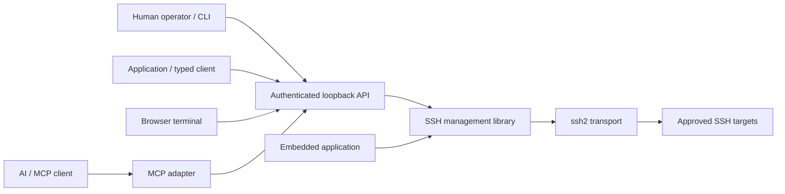

# SSH Manager

[](https://github.com/stark-ai-de/ssh-manager/actions/workflows/validate.yml)
[](LICENSE)

**Reusable SSH management for TypeScript applications and AI/MCP clients, with a local daemon and shared browser terminals.**

Build on one SSH engine instead of implementing credentials, host verification, permissions and session lifecycles separately in every integration.

[Get started](docs/getting-started.md) · [Use with MCP](docs/mcp.md) · [Embed the library](docs/library.md) · [Compare alternatives](docs/comparison.md) · [Documentation](docs/README.md)

> **Early-stage software, best-effort support.** Package versions are currently `1.0.0`; this is not a claim of production certification, a security audit, published npm availability or universal platform support. See [compatibility and limitations](docs/compatibility.md).

## What you can do

- Manage host profiles, groups, SSH-agent/key-file/encrypted-vault credentials and explicitly reviewed target grants.
- Share verified connections across terminals, asynchronous jobs, SFTP transfers and local/remote/SOCKS tunnels.
- Attach several terminal readers with one authenticated writer; detaching a client does not stop a daemon-owned session.
- Connect directly, through approved jump hosts, or through SOCKS5/HTTP CONNECT proxies.
- Expose individual MCP tools without letting tool arguments supply credentials or grant permissions.
- Embed the library without HTTP or MCP, or use the typed client to share the daemon.

**Not a hosted service, multi-user bastion, full desktop SSH client, or command sandbox.** A `shell` grant permits arbitrary commands as the remote account. Plain PTYs can be lost on connection loss; reconnect never reruns jobs. Optional pre-existing tmux enables explicit recovery, not guaranteed continuity.

## How it fits together



The daemon embeds the library and owns its connections. The embedded-application path is an **alternative owner with a separate state directory**, not a second owner of daemon state. [Architecture and lifecycle diagrams →](docs/architecture.md)

## Quick start from source

Prerequisites: **Node.js 24.18.0 or newer**, **pnpm 12.9.1**, Git and `tar` (used by the package smoke check; available on typical Linux/macOS and current Windows installations). Install missing tools using your platform's trusted package manager; no remote shell installer is required.

```sh
git clone https://github.com/stark-ai-de/ssh-manager.git
cd ssh-manager
pnpm install --frozen-lockfile --ignore-scripts
pnpm validate
node packages/ssh-manager-runtime/dist/cli.js help
```

This builds and validates locally; it does not connect to your servers. Continue with the [first-connection walkthrough](docs/getting-started.md) to start the daemon, register a credential reference, verify a host key and grant capabilities. An unapproved target cannot connect.

For MCP, use the [copyable stdio configuration](docs/mcp.md). For a reusable library, see [embedding and local package installation](docs/library.md). Consumers of a reviewed runtime bundle can run `node runtime/cli.mjs` or `node runtime/mcp.mjs` without a source checkout or dependency installation at startup; see [distribution and verification](docs/releases.md).

## Packages

| Package                         | Responsibility                                                                               |
| ------------------------------- | -------------------------------------------------------------------------------------------- |
| `@stark-ai/ssh-manager`         | Canonical SSH management, trust/grants, vault, PTYs, jobs, files, tunnels and metadata audit |
| `@stark-ai/ssh-manager-runtime` | Authenticated HTTP/WebSocket API, typed client, CLI, daemon and browser viewer               |
| `@stark-ai/ssh-manager-mcp`     | Individual MCP tools calling the management API; no separate SSH engine                      |

Package names, public exports and the `/v1/` API are preserved. No Mechas or Skills plugin installation is required. The separate [Agent Skills repository](https://github.com/stark-ai-de/agent-skills) can consume pinned runtime artifacts; it is not a runtime dependency.

## Develop and contribute

```sh
pnpm validate          # formatting, build, docs, tests and local package checks
pnpm test              # fixtures after a build; no real server credentials
pnpm docs:check        # offline Markdown links/anchors, JSON examples and YAML syntax
pnpm pack:check        # inspect local package tarballs; never publishes
```

[Contributing](CONTRIBUTING.md) explains optional native/browser fixtures and how to test safely. [Validation](docs/validation.md) distinguishes fixture evidence from platform qualification. Artifact export requires clean committed source and records that exact revision.

- [Report a bug or request a feature](https://github.com/stark-ai-de/ssh-manager/issues/new/choose)
- [Get support](SUPPORT.md) · [Security reporting](SECURITY.md) · [Code of conduct](CODE_OF_CONDUCT.md)
- [Governance](GOVERNANCE.md) · [Changelog](CHANGELOG.md) · [Roadmap](docs/roadmap.md)

## License

[Apache-2.0](LICENSE). Runtime bundles carry their dependency license notices; the project license does not replace third-party licenses.
