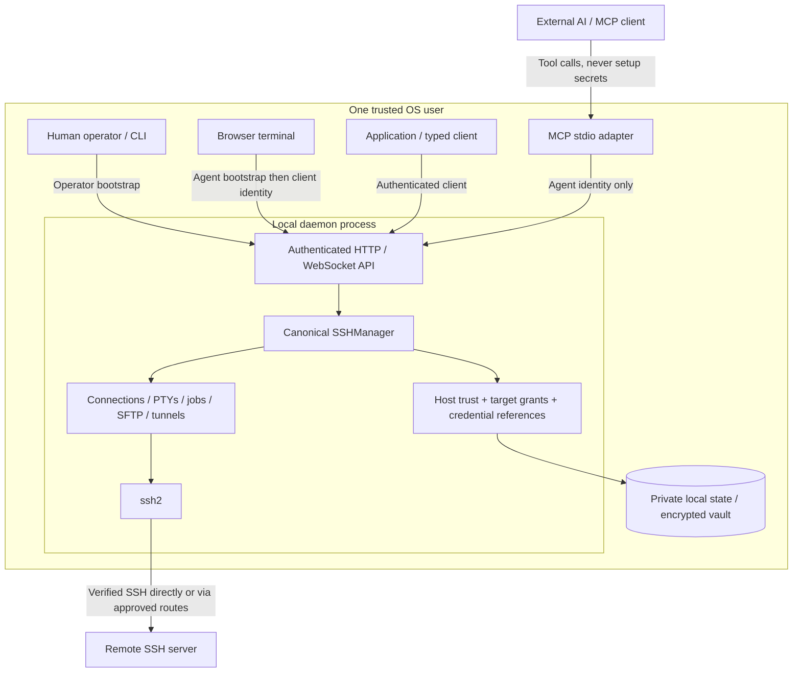
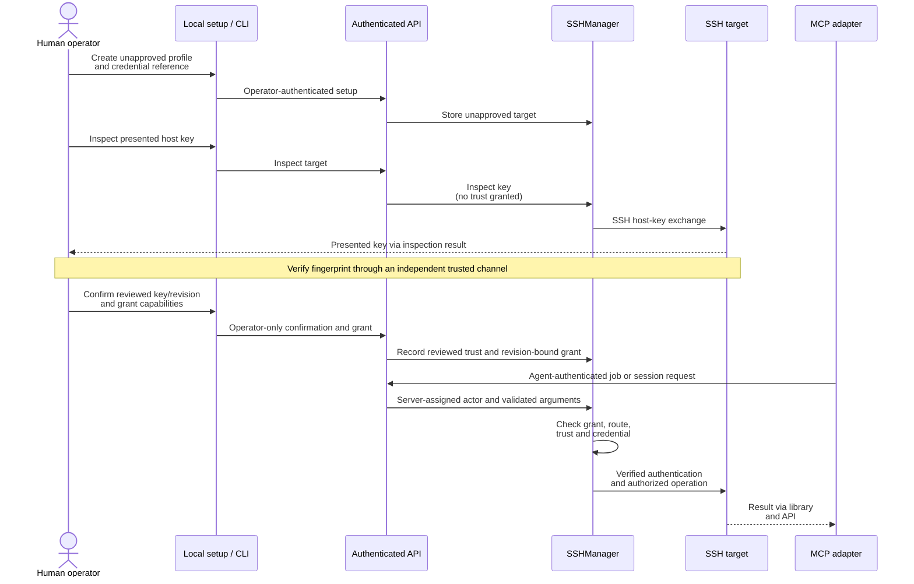
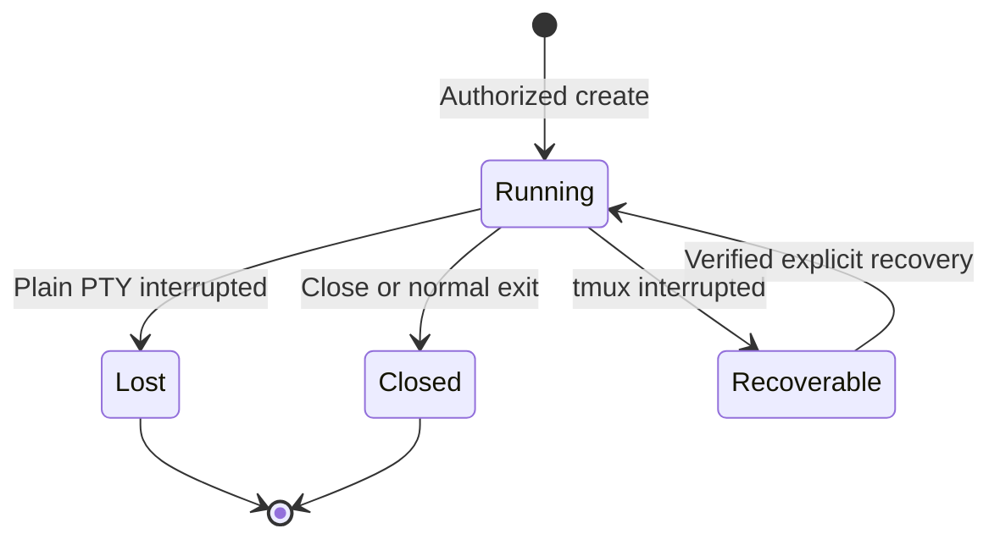
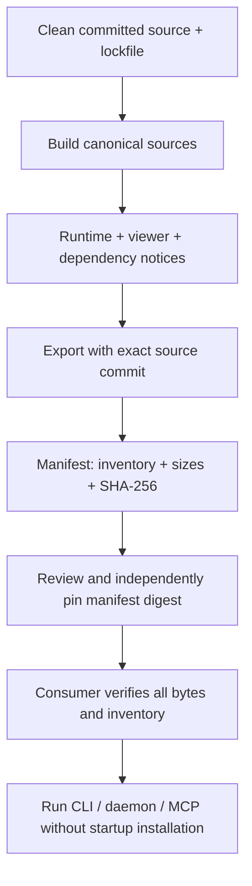

# Architecture

SSH Manager has one canonical management library, an optional local runtime, and a thin MCP adapter. The runtime owns long-lived SSH connections and terminal sessions; clients attach to those resources rather than owning separate SSH transports.

## Components and trust boundaries

The loopback API validates authentication, Host and browser Origin. A bootstrap token creates a server-assigned, expiring client identity; tool arguments cannot impersonate another writer or operator. Multiple readers may observe a terminal, but only one authenticated writer holds the input lease. The OS user and trusted embedding code remain security boundaries: this is not isolation from malicious same-user processes.

| Package                        | Owns                                                                          | Must not own                                            |
| ------------------------------ | ----------------------------------------------------------------------------- | ------------------------------------------------------- |
| `packages/ssh-manager`         | Management contracts/errors, state, vault, trust, grants, resource lifecycles | HTTP, Fastify or MCP                                    |
| `packages/ssh-manager-runtime` | API/authentication, typed client, CLI, daemon, viewer                         | A second implementation of SSH policy                   |
| `packages/ssh-manager-mcp`     | Tool schemas/annotations and management client calls                          | Direct SSH connections, secret setup or operator grants |

An embedded application can instantiate the library without HTTP/MCP and own its lifecycle. It must use an independent state directory and authenticate its own actors. Simultaneous embedders must not own the same state directory, and must not compete with the daemon for its state. Boundary and public-declaration tests enforce the package dependency direction.

## From human approval to a remote operation

Inspection alone is not verification. MCP cannot confirm host trust, submit secrets or grant capabilities. Endpoint, credential, route and trust changes invalidate affected authority/connections. Arbitrary shell execution is a powerful write capability; SFTP roots do not contain shell commands.

## Terminal lifecycle

Reader attach/detach, viewer exit and vault lock leave a running authenticated session running. A lost plain PTY requires explicit creation of a new terminal, not a transition back to the old session. `recoverable` is a candidate state, not proof that the remote tmux session still exists; failed recovery does not establish continuity. tmux must already be installed on a suitable Unix target; the runtime never installs it. Target reboot normally loses both plain PTYs and tmux. Closing a tmux-backed channel may leave remote tmux processes running.

Jobs have their own lifecycle (`running`, `succeeded`, `failed`, `cancelled`, `unknown`). Reconnect **never replays a job**; cancellation does not prove remote descendants stopped. In-memory output is bounded, and terminal cursor gaps require a fresh attach snapshot. Vault lock prevents new vault-based authentication and pauses recording, not existing authenticated session use.

## Source to consumer

The manifest binds artifact bytes to an exact producer revision. A digest obtained only from the same untrusted download is not proof of publisher identity: consumers need a separately trusted pin. Verification never executes the candidate. Publication, import into another repository and live installation switches require explicit authorization.

The Skills plugin repository consumes reviewed, pinned generated artifacts. Source ownership is independent of it; Mechas is a possible client, not a required dependency. See [artifact contract](artifact-contract.md), [security model](security-model.md), [operations](operations.md) and [releases](releases.md).
